# 🚀 Personal Portfolio Website


Personal Portfolio Website merupakan platform digital yang dikembangkan secara mandiri untuk menampilkan profil profesional, pengalaman kerja, pendidikan, sertifikasi, keahlian teknis, dan berbagai project di bidang teknologi informasi, data analytics, serta software development.

Project ini dibangun menggunakan HTML5, CSS3, dan Vanilla JavaScript dengan fokus pada desain responsif, navigasi yang intuitif, serta pengalaman pengguna yang konsisten di berbagai perangkat.

---

## 📌 1. Project Overview

Website ini berfungsi sebagai **digital professional portfolio** yang mengintegrasikan informasi pribadi dan profesional ke dalam satu platform.

Melalui website ini, pengunjung dapat mengenal latar belakang pendidikan, pengalaman profesional, kompetensi teknis, serta berbagai project yang pernah dikembangkan.

Pengembangan dilakukan secara mandiri tanpa bergantung pada template UI pihak ketiga, sehingga struktur halaman, styling, dan interaksi dibuat menggunakan teknologi frontend native.

### Project Objectives

- **Professional Branding:** Membangun identitas profesional secara digital.
- **Career Showcase:** Menampilkan pengalaman kerja, pendidikan, dan sertifikasi.
- **Technical Portfolio:** Mendokumentasikan project dan kemampuan teknis.
- **Responsive Experience:** Memberikan tampilan optimal pada desktop maupun perangkat mobile.
- **Frontend Development:** Mengimplementasikan HTML, CSS, dan JavaScript secara mandiri.

---

## 🌐 2. Live Demo

✨ **Website:** [Imammul Arif – Personal Portfolio](https://imammularif.github.io/My-Portofolio-1.0/)

<text>Repository: [My-Portofolio-1.0](https://github.com/imammularif/My-Portofolio-1.0)</text>

---

## 📸 3. Interface Documentation

Dokumentasi berikut menampilkan implementasi antarmuka website pada perangkat desktop dan mobile.

### 3.1 Desktop Preview

| Landing Page | Projects Section |
|:---:|:---:|
|  |  |


### 3.2 Mobile Preview

<table align="center">
  <tr>
    <td align="center"><b>Home</b><br/>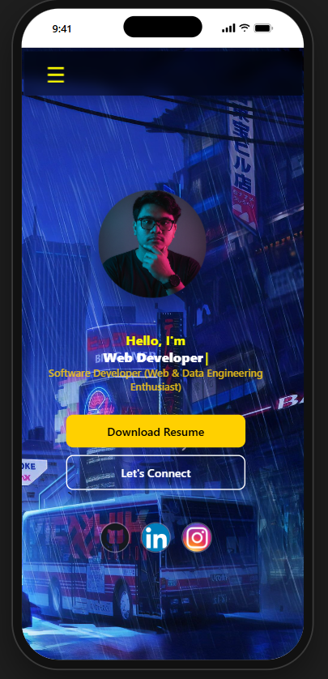</td>
    <td align="center"><b>About</b><br/>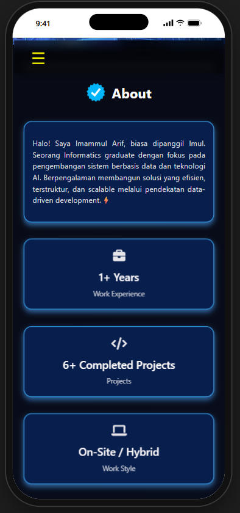</td>
    <td align="center"><b>Career</b><br/>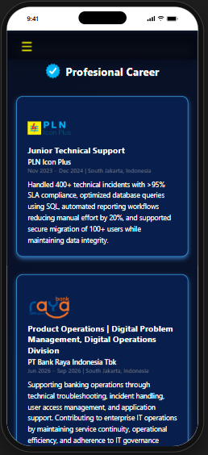</td>
    <td align="center"><b>Education</b><br/>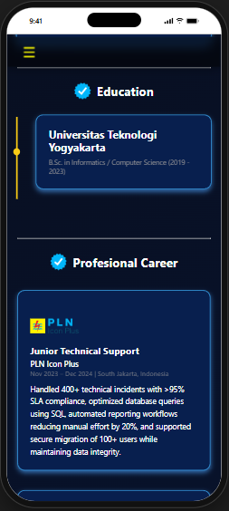</td>
    <td align="center"><b>Skills</b><br/>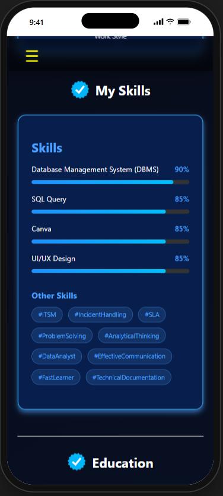</td>
  </tr>
  <tr>
    <td align="center"><b>Certifications</b><br/>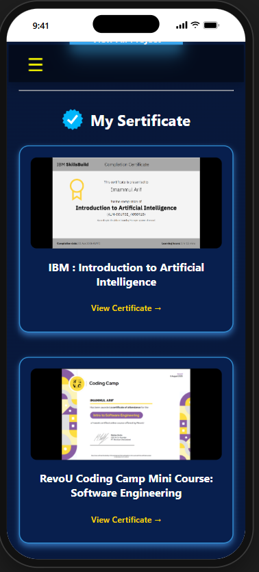</td>
    <td align="center"><b>Projects</b><br/>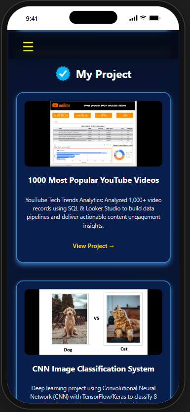</td>
    <td align="center"><b>Get in Touch</b><br/>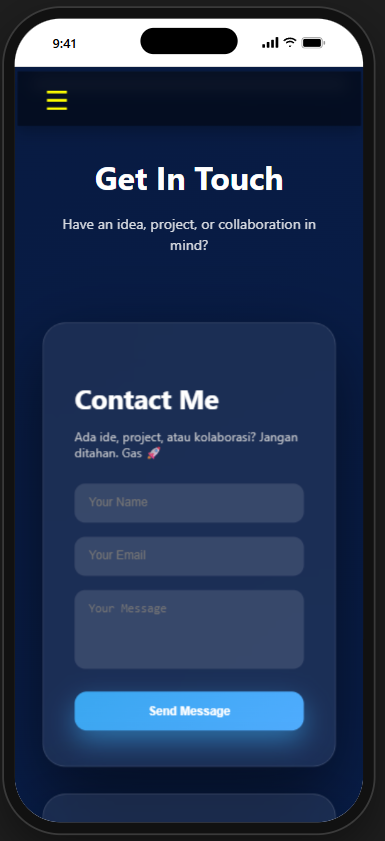</td>
    <td align="center"><b>Navigation</b><br/>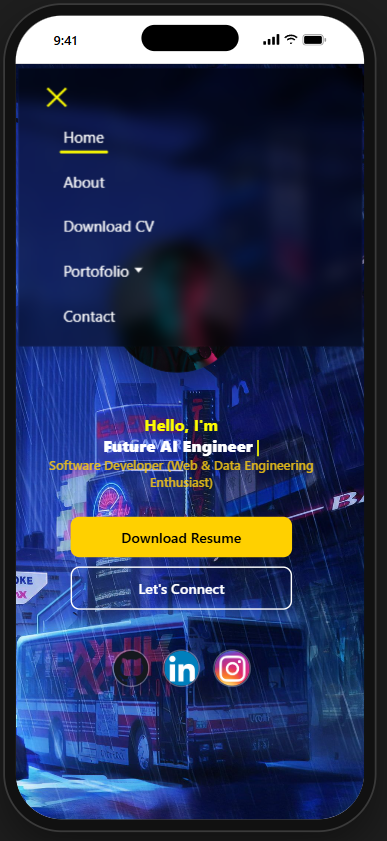</td>
    <td align="center"><b>Footer</b><br/>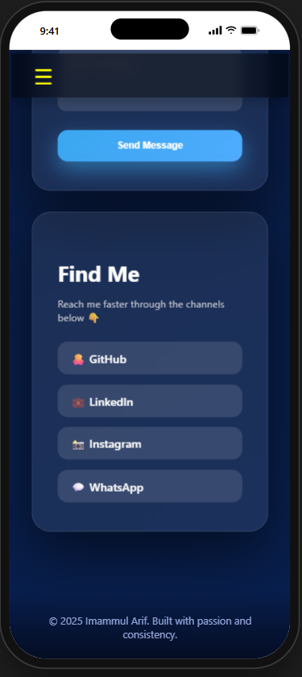</td>
  </tr>
</table>


### 3.3 Tablet Preview

Dokumentasi tampilan tablet menunjukkan adaptasi layout website pada ukuran layar menengah, termasuk bagian profil, pendidikan, pengalaman, dan project.

<table align="center">
  <tr>
    <td align="center" width="33%">
      <b>Tablet Overview</b><br/>
      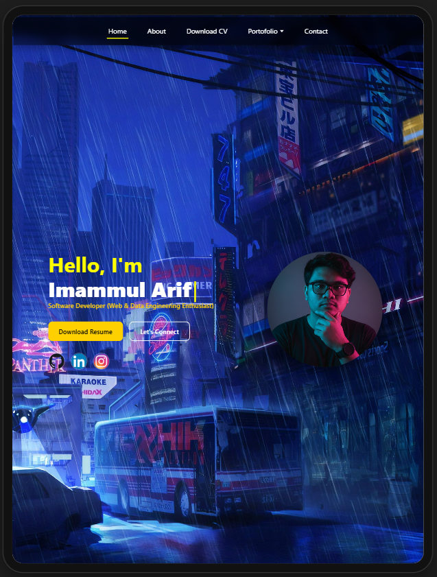
    </td>
    <td align="center" width="33%">
      <b>About & Skills</b><br/>
      
    </td>
    <td align="center" width="33%">
      <b>Education</b><br/>
      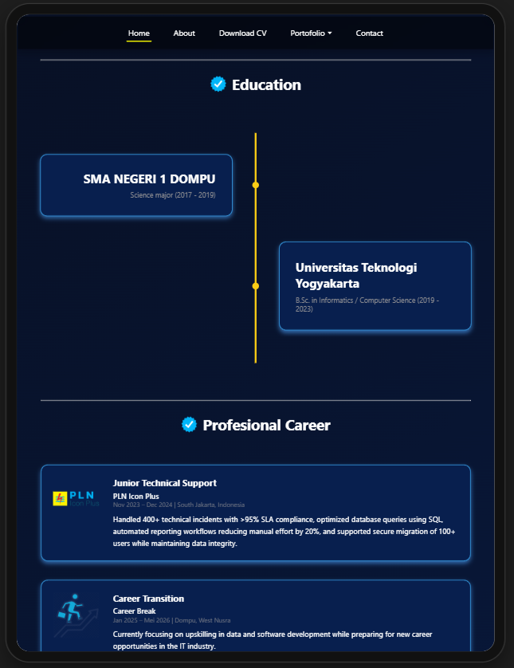
    </td>
  </tr>
  <tr>
    <td align="center">
      <b>Career</b><br/>
      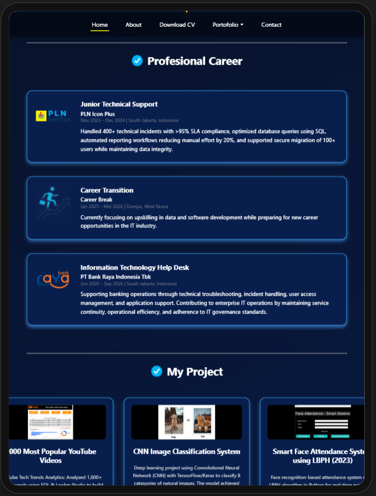
    </td>
    <td align="center">
      <b>Projects</b><br/>
      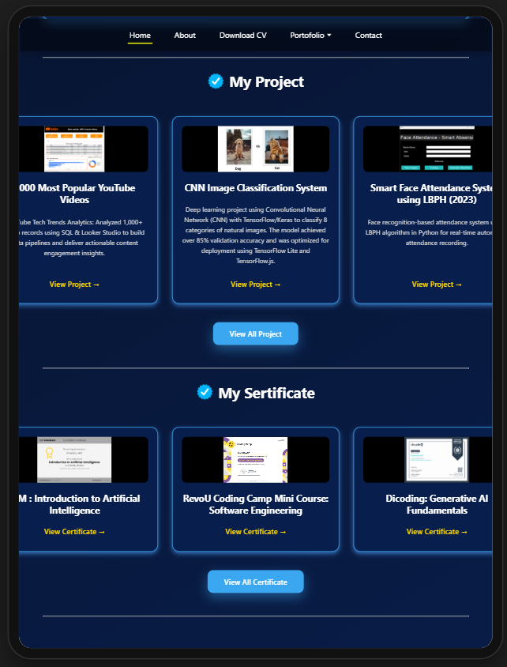
    </td>
    <td align="center">
      <b>Footer</b><br/>
      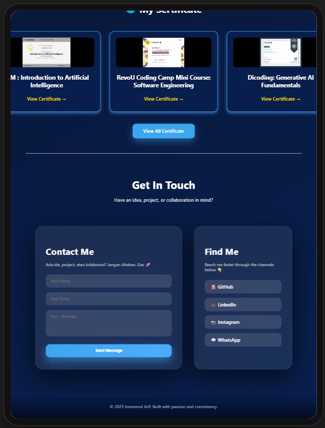
    </td>
  </tr>
</table>


---

## 🛠️ 4. Technology Stack

### 4.1 Frontend Development

| Technology | Implementation |
|---|---|
| HTML5 | Struktur dan semantic markup website |
| CSS3 | Styling, layout, animasi, dan responsive design |
| JavaScript (ES6+) | Interaksi dan dynamic behavior |

### 4.2 Layout & Responsive Design

- CSS Flexbox untuk pengaturan layout.
- CSS Grid untuk struktur konten.
- Media Queries untuk berbagai ukuran layar.
- CSS Transitions dan Keyframe Animations untuk micro-interactions.
- Responsive navigation untuk perangkat mobile.

### 4.3 Development Tools

| Tools | Purpose |
|---|---|
| Visual Studio Code | Code editor |
| Google Chrome DevTools | Debugging dan inspeksi tampilan |
| Git | Version control |
| GitHub | Repository management |
| GitHub Pages | Website deployment |

---

## 🧩 5. Website Structure & Features

Website dibagi menjadi beberapa bagian utama:

| Section | Description |
|---|---|
| Home | Halaman utama dan pengenalan profil profesional |
| About | Informasi singkat mengenai latar belakang dan profil |
| Career | Timeline pengalaman profesional |
| Education | Riwayat pendidikan |
| Skills | Daftar kompetensi dan teknologi yang dikuasai |
| Certifications | Dokumentasi sertifikasi dan pelatihan |
| Projects | Showcase berbagai project yang dikembangkan |
| Get in Touch | Informasi dan akses kontak profesional |
| Footer | Informasi penutup dan navigasi tambahan |

---

## 📁 6. Project Structure

The project uses a simple and organized directory structure to separate HTML pages, CSS stylesheets, JavaScript functionality, image assets, certificates, and interface documentation.

```text
My-Portofolio/
│
├── certificate.html
├── cv.html
├── index.html
├── mini_project.html
├── README.md
├── script.js
│
├── css/
│   ├── certificate.css
│   ├── cv.css
│   ├── mini_project.css
│   └── styles.css
│
├── image/
│   ├── BANK-RAYA.png
│   ├── bg.jpg
│   ├── imul.png
│   ├── PLN-Icon-Plus.png
│   ├── validasi.webp
│   │
│   ├── favicon_io/
│   │   ├── favicon.ico
│   │   ├── favicon-16x16.png
│   │   ├── favicon-32x32.png
│   │   ├── android-chrome-192x192.png
│   │   ├── android-chrome-512x512.png
│   │   ├── apple-touch-icon.png
│   │   └── site.webmanifest
│   │
│   ├── icon/
│   │   └── [Technology, platform, and organization icons]
│   │
│   ├── project/
│   │   └── [Project and application preview images]
│   │
│   └── sertif/
│       ├── 2023/
│       │   └── [Certificate images]
│       │
│       ├── 2025/
│       │   ├── [Certificate images]
│       │   ├── gc/
│       │   ├── HR/
│       │   └── SV/
│       │
│       └── 2026/
│           ├── Dicoding/
│           └── IBM/
│
└── Preview/
    ├── LandingPage.png
    ├── Project.png
    │
    ├── phone/
    │   └── [Mobile interface screenshots]
    │
    └── tablet/
        └── [Tablet interface screenshots]
```

### Directory Description

| File / Directory | Description |
|---|---|
| `index.html` | Main portfolio landing page. |
| `certificate.html` | Page displaying professional certificates and learning achievements. |
| `cv.html` | Online CV page. |
| `mini_project.html` | Page showcasing mini projects and practical work. |
| `script.js` | JavaScript functionality and interactive website behavior. |
| `css/` | Contains CSS stylesheets for the website and its individual pages. |
| `image/` | Stores website images, profile assets, company logos, and other visual resources. |
| `image/icon/` | Technology, platform, and organization icons. |
| `image/project/` | Images used to illustrate projects and applications. |
| `image/sertif/` | Certificate documentation organized by year and provider. |
| `image/favicon_io/` | Website favicon and browser application icons. |
| `Preview/` | Interface documentation and website screenshots. |
| `Preview/phone/` | Mobile interface screenshots. |
| `Preview/tablet/` | Tablet interface screenshots. |

The directory structure is designed to keep the source code and visual assets organized, making the portfolio easier to maintain and update.

---

## ⚡ 7. Technical Highlights

### Responsive Web Design
Website dirancang agar dapat menyesuaikan ukuran layar desktop, tablet, dan smartphone menggunakan CSS Media Queries.

### Native Frontend Implementation
Struktur dan interaksi dikembangkan menggunakan HTML5, CSS3, dan Vanilla JavaScript tanpa ketergantungan pada framework frontend besar.

### Custom UI Components
Elemen antarmuka seperti navigation menu, timeline, project cards, dan berbagai bagian halaman dirancang dan dikembangkan sesuai kebutuhan portfolio.

### Lightweight Architecture
Penggunaan teknologi frontend native membantu menjaga struktur project tetap sederhana dan mudah dikelola.

### Version Control
Git dan GitHub digunakan untuk mengelola perubahan kode, dokumentasi, serta riwayat pengembangan project.

---

## 📚 8. Development & Key Learnings

Beberapa pembelajaran yang diperoleh selama pengembangan:

- Mengimplementasikan struktur semantic HTML.
- Mengembangkan layout menggunakan CSS Flexbox dan Grid.
- Mengatur responsive breakpoint untuk berbagai perangkat.
- Mengembangkan interaksi menggunakan Vanilla JavaScript.
- Memahami konsistensi UI/UX antara desktop dan mobile.
- Melakukan debugging menggunakan Chrome Developer Tools.
- Mengelola source code dan dokumentasi menggunakan Git dan GitHub.
- Melakukan deployment website melalui GitHub Pages.

---

## 🗺️ 9. Future Development Roadmap

Beberapa pengembangan yang dapat dilakukan selanjutnya:

- [ ] **Dark Mode:** Menambahkan pilihan Light Mode dan Dark Mode.
- [ ] **Contact Form Integration:** Mengintegrasikan layanan seperti EmailJS atau Formspree.
- [ ] **Performance Optimization:** Mengoptimalkan ukuran gambar dan implementasi lazy loading.
- [ ] **SEO Enhancement:** Meningkatkan metadata dan optimasi mesin pencari.
- [ ] **Accessibility Improvement:** Meningkatkan aksesibilitas dan pengalaman navigasi.
- [ ] **UI/UX Enhancement:** Melakukan penyempurnaan tampilan dan interaksi website.

---


## 📊 10. Project Status


**Status: Archived — No Longer Maintained**

Website portfolio ini sudah tidak aktif dan tidak lagi dikembangkan maupun dipelihara sebagai website publik.

Repository tetap dipertahankan sebagai dokumentasi perjalanan pengembangan, implementasi frontend, responsive design, serta personal branding.

Source code dan dokumentasi visual tetap tersedia untuk keperluan referensi dan portfolio development history.


---

## 👨‍💻 11. Author

**Imammul Arif**

- Location: Indonesia
- LinkedIn: [linkedin.com/in/imammularif](https://linkedin.com/in/imammularif)
- GitHub: [github.com/imammularif](https://github.com/imammularif)

---

*Developed independently as a personal branding and professional portfolio project.*
